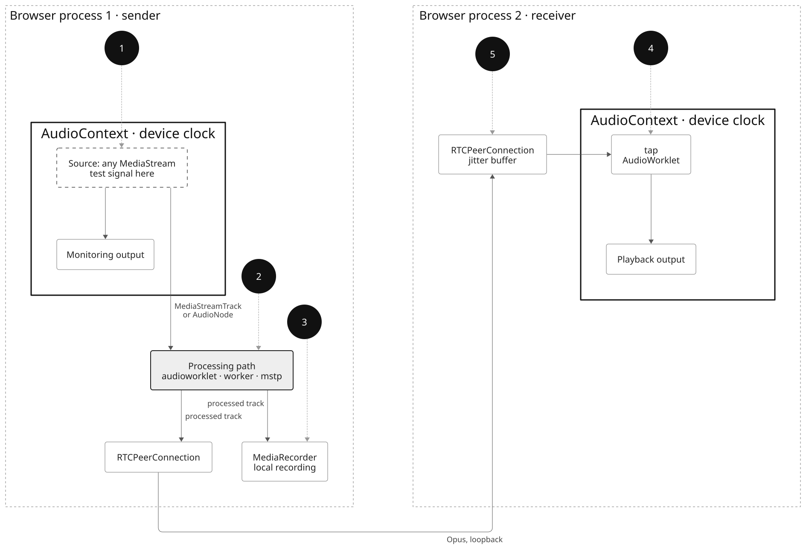

# Audio processing: MSTP/G vs. web standards

Audio from a MediaStreamTrack can be processed with MediaStreamTrackProcessor
and MediaStreamTrackGenerator (MSTP/G), or with web standards: an AudioWorklet
in a sinkless AudioContext, or a dedicated worker connected through
SharedArrayBuffer. This repository runs the same processing on each, and
measures the audio that reaches the recording and the listener, including when
processing stalls and when the machine is overloaded.

The results, with the likely cause of each failure, are written up in a single
page: `just site` builds [site/index.html](site/index.html).

| Path | Processing runs in | Diagram |
|---|---|---|
| `audioworklet` | an AudioWorklet, in an `AudioContext` with `sinkId: { type: "none" }` | [audioworklet](docs/diagrams/audioworklet.svg) |
| `worker` | a dedicated worker, with AudioWorklets moving audio through SharedArrayBuffer rings | [worker](docs/diagrams/worker.svg) |
| `mstp` | a dedicated worker, between MediaStreamTrackProcessor and MediaStreamTrackGenerator (Chromium) | [mstp](docs/diagrams/mstp.svg) |

Each trial is a call between two browser processes on one machine. The sender
monitors its input, processes it and sends it over WebRTC. The receiver plays
it. The sender also records the processed track locally, as apps sometimes do
for safety.



1. Source: when each block of the test signal was generated.
2. Processed audio, where it leaves the processing.
3. Local MediaRecorder recording of the processed track.
4. Received audio, timed at the output device with `getOutputTimestamp()`.
5. Receiver jitter buffer, from `getStats()`.

## Requirements

- macOS or Linux. Our results: macOS 26, Apple M4 Max.
- [uv](https://docs.astral.sh/uv/), Chrome, `ffmpeg`.
- `stress-ng` for the contention experiment.
- Safari, for `timestamps` only: `sudo safaridriver --enable`, then Develop ▸ Allow Remote Automation.
- Firefox: a patched build, see [firefox/](firefox/README.md) for downloads
  and what the patches add.
- [just](https://just.systems/) to build the page, and
  [d2](https://d2lang.com/) with the [Inter](https://rsms.me/inter/) font to
  re-render the diagrams.

WebDriver binaries are fetched by Selenium Manager.

## Running

```sh
uv run repro trial --browser chrome --path mstp --out results/first   # One 22 s call, analyzed.
uv run repro run stalls                                                # Chrome paths only.
uv run repro --firefox /path/to/firefox run stalls                     # Chrome and Firefox.
```

| Experiment | Question | Time |
|---|---|---|
| `stalls` | 100, 200, 500 ms stalls. Is all processed audio delivered? How fast does processing catch up? | 18 min |
| `playout` | One 500 ms stall in a 60 s call. When does the listener's delay return to normal? | 65 min |
| `contention` | 16384-tap filter, 64 `stress-ng` workers for 20 s. Does processing keep up? | 30 min |
| `timestamps` | Worker recording gated by an independently clocked video source, ±200 ppm. Do audio and video timestamps stay aligned through stalls? | 2 min |

Times are for both browsers with three rounds (`--rounds`). Each experiment
writes `results/<experiment>-<time>/summary.md`, and keeps every trial's raw
data next to it. `uv run repro summarize <directory>` re-analyzes a directory.

Tests for the analysis: `uv run --group dev pytest`. `just site` rebuilds the
page from `results/`, `just diagrams` the diagrams from `docs/diagrams/*.d2`.

## Results

macOS 26.6.2, Apple M4 Max, 44.1 kHz output. Chrome 156.0.8078.47. Firefox
160.0a1, patched build 20261022160632. Safari 26.6.2. Three trials per arm (one
for `timestamps`); ranges are minimum–maximum.

### `stalls`

| Arm | Recorded audio intact | Recording timeline intact | Catch-up after 500 ms stall, ms | Backlog before stalls (p95), ms | Source → playback before stalls, ms |
| --- | --- | --- | --- | --- | --- |
| firefox-audioworklet-128 | 3/3 | 3/3 | 1, 1, 1 | 16–20 | 83–87 |
| firefox-audioworklet-512 | 3/3 | 3/3 | 0, 1, 1 | 23–28 | 97–104 |
| firefox-worker-128 | 3/3 | 3/3 | 2, 2, 2 | 9–15 | 76–83 |
| chrome-audioworklet-128 | 0/3 | 0/3 | never, never, never | 27–32 | 119–133 |
| chrome-audioworklet-512 | 0/3 | 0/3 | never, never, never | 22–27 | 115–127 |
| chrome-worker-128 | 3/3 | 0/3 | never, never, never | 9–15 | 99–118 |
| chrome-mstp-128 | 3/3 | 0/3 | 1, 1, 1 | 5–6 | 81–90 |

### `playout`

| Arm | Source → playback before stall, ms | Peak after stall, ms | Added delay, last 5 s, ms | Jitter buffer, last 5 s, ms | Recorded audio intact |
| --- | --- | --- | --- | --- | --- |
| firefox-audioworklet-128 | 81–90 | 546–582 | 299–357 | 318–365 | 3/3 |
| firefox-audioworklet-512 | 92–100 | 578–586 | 288–305 | 304–316 | 3/3 |
| firefox-worker-128 | 73–105 | 531–558 | 272–309 | 300–329 | 3/3 |
| chrome-audioworklet-128 | 120–143 | 152–600 | 14–41 | 38–58 | 0/3 |
| chrome-audioworklet-512 | 107–132 | 579–607 | 75–109 | 43–59 | 0/3 |
| chrome-worker-128 | 94–123 | 596–632 | 472–508 | 51–63 | 3/3 |
| chrome-mstp-128 | 85–96 | 557–567 | 305–409 | 329–435 | 3/3 |

### `contention`

| Arm | Recorded audio intact | Backlog p95, ms (before / load / after) | DSP ms per audio s | Source → playback p50, ms | Jitter buffer target, ms | Concealed under load, ms |
| --- | --- | --- | --- | --- | --- | --- |
| firefox-audioworklet-128 | 3/3 | 18–21 / 22–23 / 22–23 | 134–313 / 124–125 / 124–150 | 85–127 / 92–126 / 90–118 | 20–60 / 20–60 / 20–60 | 0 |
| firefox-worker-128 | 3/3 | 15 / 15–96 / 15 | 173–264 / 158–232 / 126–175 | 100–119 / 117–275 / 104–231 | 60–80 / 60–200 / 40–100 | 0–72 |
| chrome-audioworklet-128 | 3/3 | 22–32 / 22–32 / 22–32 | 129–160 / 127–129 / 125–168 | 101–131 / 101–131 / 96–126 | 20–40 / 20–40 / 20–40 | 0 |
| chrome-worker-128 | 3/3 | 15 / 15–20 / 15–20 | 152–172 / 128–136 / 130–172 | 102–127 / 102–127 / 98–123 | 40 / 40 / 40 | 0 |
| chrome-mstp-128 | 3/3 | 5 / 6 / 5–6 | 127–144 / 127 / 127–179 | 83–86 / 82–86 / 78–82 | 20 / 20 / 20 | 0 |
| firefox-audioworklet-128-no-rt | 2/3 | 27 / 28–145 / 28–54 | 125–308 / 144–242 / 127–189 | 83–94 / 110–308 / 109–302 | 20–40 / 40–220 / 40–180 | 0–163 |

### `timestamps`

| Arm | Audio exact | Median offset, ms | p95 deviation, ms | Max deviation around stalls, ms |
| --- | --- | --- | --- | --- |
| chrome-mstp--200ppm | yes | 0.5 | 2.8 | 2.8 |
| chrome-mstp-0ppm | yes | -1.3 | 2.7 | 3.0 |
| chrome-mstp-200ppm | yes | -1.5 | 2.9 | 3.1 |
| firefox-worker--200ppm | yes | -7.8 | 2.7 | 2.7 |
| firefox-worker-0ppm | yes | -7.4 | 2.8 | 2.9 |
| firefox-worker-200ppm | yes | 1.0 | 3.9 | 2.3 |
| safari-worker--200ppm | yes | -0.1 | 0.6 | 0.7 |
| safari-worker-0ppm | yes | 2.5 | 0.6 | 0.6 |
| safari-worker-200ppm | yes | 0.8 | 0.8 | 0.8 |

### Subnormals

A separate benchmark, [denormals/](denormals/): DSP whose state decays into the
subnormal range runs 38–73× slower on every Intel CPU tested, in JavaScript and
WebAssembly. Firefox flushes subnormals to zero for WebAssembly in
`AudioWorkletProcessor.process()` only. See the Subnormals section of the page.

## Method

- **Signal** ([signal.js](web/signal.js)): pseudorandom values every millisecond, linearly interpolated. Any 80 ms window identifies its position; the analysis computes the expected output independently ([signal.py](repro/signal.py)).
- **Processing** ([dsp.js](web/dsp.js)): block copy, or a FIR filter in WebAssembly SIMD ([fir.wat](web/fir.wat)), identical in every path. Stalls busy-wait on the processing thread.
- **Positions** ([matching.py](repro/matching.py)): band-passed normalized cross-correlation, with score and uniqueness thresholds. Unidentified windows are reported, never guessed.
- **Catch-up** ([analysis.py](repro/analysis.py)): source audio generated but not yet processed. Recovered: back under the pre-stall 95th percentile plus one source batch, for at least 500 ms.
- **Recording** ([recording.py](repro/recording.py)): every 10 ms of the expected processed signal must be present, in order and at the right level, through Opus; container timestamps must be contiguous.
- Every `AudioContext` runs at the device's sample rate. Sinkless contexts use their source's rate.

## Repository

| Directory | Contents |
|---|---|
| `repro/` | Harness (`uv run repro`) and analysis |
| `web/` | Pages, worklets and workers that run in the browsers |
| `results/` | Summaries of the runs above; raw trial data stays local |
| `site/` | The results page: `page.html`, `site.toml`, `content/*.md` |
| `docs/diagrams/` | d2 sources and rendered diagrams |
| `denormals/` | Subnormal benchmark: `node bench.js`, or open `denormals.html` |
| `firefox/` | Patched Firefox builds and what the patches add |
| `tests/` | Analysis tests |

## License

[MPL 2.0](LICENSE).
